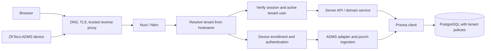

# HRM SaaS architecture plan

## Scope and stack

Each customer is a tenant with a unique subdomain (`acme.example.com`). The initial application is one Nuxt app with server-rendered pages and Nitro API routes, Nuxt UI for the interface, Prisma as the database client and migration tool, and PostgreSQL for persistent data. Keep the Prisma client and all database access on the server. Choose and pin compatible major versions when implementation begins; the plan does not depend on a particular Prisma client API.

Use one shared PostgreSQL database and schema for the first release. This keeps onboarding and migrations simple while allowing many small tenants. Every tenant-owned row has a `tenant_id`. A dedicated database per tenant is a later option for customers with contractual isolation needs, not the default design.

## Request and authorization flow



1. Configure wildcard DNS and TLS for `*.example.com`; route the apex domain separately for public pages and platform administration. Reserve names such as `www`, `admin`, and `api` during customer provisioning.
2. At the trusted edge, accept only configured base domains and pass a normalized hostname to Nuxt. Trust forwarded host headers only from the configured proxy. Reject malformed hosts, extra subdomain levels, unknown slugs, and inactive tenants before serving tenant pages or APIs.
3. Resolve the hostname to a stable tenant ID in Nitro server middleware and attach it to request context. A slug may change; tenant IDs do not. Never use a tenant ID supplied by the browser as the authority for a request.
4. Authenticate web users with a secure, HTTP-only, host-only session cookie on the tenant subdomain. Confirm that the auth account links to an active tenant-local user in the resolved tenant on every protected request. Check assigned permissions and data scope in the server handler. Do not rely on Nuxt page middleware alone for API security.
5. Authenticate device requests separately from web sessions. Match the registered device's tenant to the tenant derived from the subdomain on every request, then pass accepted traffic to an isolated ADMS adapter. The local skylinebiz/adms reference uses a base URL path followed by device-appended `/iclock/*` routes; for our subdomains the candidate mount is `/<device-secret>/iclock/*`. The secret does not replace hostname-based tenant resolution. See the [ADMS URL design](../SPEC.md#33-zkteco-adms-device-management).
6. Pass an explicit tenant context into domain services. Those services own validation and all reads and writes. The browser calls same-origin Nitro APIs; it never connects to PostgreSQL or imports Prisma.

Nuxt's `server/` directory supports API routes and server middleware. Its request-URL documentation notes that cached responses can lose host headers unless the cache varies by host; therefore, keep authenticated tenant pages and APIs uncached initially and only add host-aware caching after tests. [Nuxt server engine](https://nuxt.com/docs/guide/concepts/server-engine/), [Nuxt request URL and caching](https://nuxt.com/docs/3.x/api/composables/use-request-url).

## Data model

The full table and constraint proposal is in [DATABASE.md](DATABASE.md). Its central rule is that ADMS punch logs are inserted with a nullable user link, then a retryable reconciliation step creates or links a provisional tenant user. Start with these groups:

| Table | Purpose | Key constraints |
| --- | --- | --- |
| `tenants` | Customer identity and lifecycle | Stable ID; unique normalized slug; status |
| `auth_accounts` | Global login identity | Unique normalized email or external identity ID |
| `users` | Tenant-local people, including provisional device-discovered users | Tenant ID; optional auth account; optional origin attendance log |
| `roles`, `role_permissions`, `user_roles` | Tenant RBAC | Tenant-scoped assignments and stable permission keys |
| `sessions` | Revocable tenant login sessions | Auth account and tenant user IDs, expiry, token hash |
| `teams`, `work_schedules` | Organization and expected attendance | Tenant ID; effective schedule dates |
| `devices`, `device_user_mappings` | ADMS enrollment and staff mapping | Unique active serial number; tenant/device/user mapping |
| `attendance_logs`, `attendance_days`, `attendance_adjustments` | Raw events, derived status, and supervisor corrections | Nullable log user link; idempotent ingestion; tenant/date indexes |
| `audit_events` | Actor, tenant, action, target, time | Append-only application access |

All future customer data tables include `tenant_id`, a tenant-scoped index for common queries, and tenant-scoped unique constraints such as `UNIQUE (tenant_id, staff_number)` on `users` when present. Use composite foreign keys where needed so a child row cannot point to a parent in another tenant. Store globally shared catalog or platform data in clearly separate tables. Keep platform operator access in a separate route and authorization path.

## Isolation rules

- Require `tenant_id` in every tenant-owned query and write through server domain services. For record lookups, use both record ID and tenant ID; a globally unique record ID alone is insufficient authorization.
- Enable PostgreSQL row-level security on tenant-owned tables before production. Set the current tenant ID within the same database transaction used for tenant queries, then apply policies that compare each row's `tenant_id` to that transaction-local value. Use a runtime database role that cannot bypass row-level security; use a separate migration role. Test this with the exact Prisma version, database driver, and connection pooler chosen for deployment.
- Run cross-tenant access tests against the database policies and through HTTP routes. Verify reads, inserts, updates, deletes, joins, and raw SQL paths. Fail closed when tenant context is absent.
- Partition storage object keys, background jobs, audit records, search indexes, and cache keys by tenant ID. Workers must receive an explicit tenant ID and enforce the same service boundary as HTTP requests.
- Do not expose one tenant's identity, existence, or data in errors returned to another tenant.

PostgreSQL policies restrict row reads and writes, but table owners and roles with `BYPASSRLS` can bypass them; `FORCE ROW LEVEL SECURITY` changes owner behavior. [PostgreSQL row security documentation](https://www.postgresql.org/docs/current/ddl-rowsecurity.html). The transaction-local tenant setting and restricted runtime role are the planned defense in depth; they require an integration test before being treated as implemented.

## Provisioning and operations

- Provision a tenant by validating and reserving its slug, creating the tenant and first administrator user in one transaction, then sending an invitation. Slug uniqueness is enforced in PostgreSQL to handle concurrent signup attempts.
- Run Prisma migrations once per deployment against the shared database, before serving a version that needs the new schema. Use additive changes when a rolling deployment may have old and new app instances at once.
- Keep database credentials and session secrets in server-only configuration. Use managed PostgreSQL backups with a restore drill. Define per-tenant export and deletion procedures before offering self-service cancellation.
- Record tenant ID, request ID, and actor ID in structured server logs and audit events. Exclude HR content and secrets from logs. Monitor login failures, unknown hosts, database errors, and cross-tenant policy failures.
- Size database connections for the number of app instances; use a compatible pooler if deployment topology requires it. Prisma's pooling behavior differs by major version, so validate it against the pinned version. [Prisma connection pooling documentation](https://www.prisma.io/docs/orm/v7/prisma-client/setup-and-configuration/databases-connections/connection-pool).

## Proposed repository layout

```text
src/
  app/                 # Nuxt pages, layouts, components, assets
  server/
    api/               # HTTP handlers
    middleware/        # Host and tenant resolution
    services/          # Tenant-aware business operations
    auth/              # Sessions and authorization
    db/                # Prisma client and tenant transaction helper
  shared/              # Types and validation safe for the browser
prisma/                # Schema and migrations
tests/                 # Unit and integration tests
docs/                  # Architecture and decisions
```

Configure Nuxt's source and server directories for `src/` during scaffolding, then verify the exact layout against the pinned Nuxt release. This follows the repository rule to place application code under `src/`. Keep `nuxt.config.ts`, package manifests, and Prisma configuration at the repository root as framework configuration. Nuxt supports configuring its source directory. [Nuxt configuration](https://nuxt.com/docs/api/configuration/nuxt-config).

## Delivery sequence

1. Scaffold Nuxt, Nuxt UI, TypeScript, formatting/linting, Prisma, PostgreSQL, and repeatable local commands; pin versions and document setup.
2. Implement tenant provisioning, host resolution, reserved names, and unknown-host behavior. Test with two local subdomains.
3. Implement auth accounts, tenant users, sessions, permission checks, and tenant-scoped API services.
4. Add schedules, device enrollment, append-first ADMS ingestion, provisional user reconciliation, daily and monthly attendance, and supervisor adjustments with cross-tenant tests, following [SPEC.md](../SPEC.md) and [DATABASE.md](DATABASE.md).
5. Add and verify PostgreSQL row-level security, backup/restore, observability, and deployment checks before production data.

## Decisions needed before implementation

- Production base domain and hosting platform or reverse proxy (determines wildcard DNS/TLS and trusted host configuration).
- Identity method: email/password, magic link, or external identity provider; whether one user can join multiple customers.
- Confirm the draft first-release feature scope and role model in [SPEC.md](../SPEC.md).
- Whether customers need custom domains, single sign-on, data residency, or dedicated databases. These are outside the first-release plan unless required.
