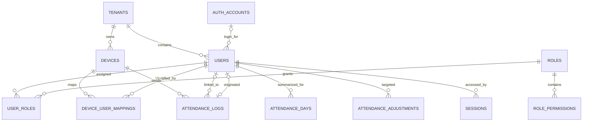

# Database structure

**Status:** V1 schema implemented in [`prisma/schema.prisma`](../prisma/schema.prisma) and [`prisma/migrations/20261016130000_initial/migration.sql`](../prisma/migrations/20261016130000_initial/migration.sql). Prisma CLI validation remains pending package access.  
**Related:** [Product spec](../SPEC.md), [architecture](ARCHITECTURE.md).

## 1. Naming and identity

`users` means people within one client tenant, including people discovered from a device punch. A `user` does not automatically have web login access. `auth_accounts` holds verified login identities globally; a tenant user may link to one account. The same auth account may link to one user in each of several tenants.

Each tenant-owned table has `tenant_id UUID NOT NULL`. Each row has a stable UUID primary key and `created_at` / `updated_at` timestamps where relevant. All operational timestamps use `timestamptz` in UTC; attendance calendar dates use PostgreSQL `date`. Tenant isolation is enforced by server services, composite foreign keys, and PostgreSQL row-level security before production. Use PostgreSQL foreign keys as the Prisma relation mode and add SQL migrations for constraints that the pinned Prisma version cannot express. [PostgreSQL constraints](https://www.postgresql.org/docs/current/ddl-constraints.html), [Prisma relation modes](https://docs.prisma.io/docs/orm/prisma-schema/data-model/relations/relation-mode).

## 2. Relationship overview

The two links between `users` and `attendance_logs` have different purposes:

- `attendance_logs.user_id` is nullable and identifies the person to whom **each** log is currently linked. One user can have many logs. A log is still inserted when this is `NULL`.
- `users.origin_attendance_log_id` is nullable and points to the **first punch that caused this user to be created automatically**. It is a provenance reference, not a pointer to all of the user's logs. Manually created users leave it `NULL`. The value is immutable after creation.

This gives the requested reference column in `users` without trying to fit a one-to-many log history into one column.

## 3. Tables

### Tenant and login

| Table | Main columns | Constraints and purpose |
| --- | --- | --- |
| `tenants` | `id`, `slug`, `name`, `status`, `time_zone`, `created_at` | `slug` is normalized and globally unique; status controls web and device access |
| `auth_accounts` | `id`, `email_normalized`, `password_hash` (nullable until login method chosen), `email_verified_at`, `status` | Globally unique normalized email; credentials are never created from a device punch |
| `users` | `id`, `tenant_id`, `auth_account_id?`, `origin_attendance_log_id?`, `staff_number?`, `display_name?`, `work_email?`, `status`, `employment_status?`, `supervisor_user_id?`, `team_id?`, `hire_date?`, `ended_on?` | Tenant-local person; statuses `provisional`, `active`, `inactive`; unique `(tenant_id, staff_number)` when present; unique `(tenant_id, auth_account_id)` when linked |
| `sessions` | `id`, `tenant_id`, `user_id`, `auth_account_id`, `token_hash`, `expires_at`, `revoked_at?` | Host-only session for one tenant; lookup always confirms an active linked user and current roles |
| `login_invitations` | `id`, `tenant_id`, `user_id`, `email_normalized`, `token_hash`, `expires_at`, `accepted_at?` | Administrator invitation; token is single-use and stored only as a hash |

`users.origin_attendance_log_id` has a same-tenant foreign key to `attendance_logs` via `(tenant_id, origin_attendance_log_id)` and is unique when present. `attendance_logs.user_id` has a same-tenant foreign key to `users` via `(tenant_id, user_id)`. Both are nullable, so ingestion can insert the log first, create a provisional user second, then link the log. The database must prevent a user from referencing another tenant's origin log.

### Permissions and organization

| Table | Main columns | Constraints and purpose |
| --- | --- | --- |
| `permissions` | `key`, `description`, `allowed_scopes` | Global catalog of stable keys such as `attendance.read` and `attendance.adjust`; tenants assign keys but do not invent new ones in V1 |
| `roles` | `id`, `tenant_id`, `name`, `is_system_template` | Unique `(tenant_id, name)`; seeded Administrator, Supervisor, and Staff templates |
| `role_permissions` | `tenant_id`, `role_id`, `permission_key`, `scope` | Unique `(role_id, permission_key, scope)`; scope is `own`, `team`, or `all` where applicable |
| `user_roles` | `tenant_id`, `user_id`, `role_id` | Unique `(tenant_id, user_id, role_id)`; same-tenant foreign keys |
| `teams` | `id`, `tenant_id`, `name`, `status` | Unique active team name within tenant; `users.team_id` is optional |
| `work_schedules` | `id`, `tenant_id`, `user_id`, `day_of_week`, `start_local_time`, `grace_minutes`, `absence_cutoff_local_time`, `effective_from`, `effective_to?` | Effective-dated expected start and cutoff for each user; no overlapping effective schedule for the same day of week |
| `holidays` | `id`, `tenant_id`, `holiday_date`, `name` | Unique `(tenant_id, holiday_date)`; excludes scheduled attendance when applicable |

`users.supervisor_user_id` is a same-tenant self-reference. A user cannot supervise themself. The authorization layer uses current direct-report assignments for `team` scope in V1. A historical manager-access policy would require effective-dated assignments and remains an open decision.

### Devices and raw attendance

| Table | Main columns | Constraints and purpose |
| --- | --- | --- |
| `devices` | `id`, `tenant_id`, `serial_number`, `secret_hash`, `name`, `time_zone`, `status`, `last_seen_at?`, `claimed_at?` | Serial number unique globally while active; statuses include `pending`, `active`, `disabled`; secret is not stored in plaintext |
| `device_user_mappings` | `id`, `tenant_id`, `device_id`, `device_user_id`, `user_id`, `effective_from`, `effective_to?` | Maps a device PIN to one tenant user for a time period; at most one active mapping for `(device_id, device_user_id)` |
| `attendance_logs` | `id`, `tenant_id`, `device_id`, `device_user_id`, `user_id?`, `occurred_local`, `device_time_zone`, `occurred_at_utc?`, `received_at`, `status_code?`, `verify_mode?`, `work_code?`, `raw_line?`, `event_key` | Immutable ADMS ATTLOG event fields; nullable `user_id` may be linked later; unique `(device_id, event_key)` prevents retry duplicates; `raw_line` is bounded and contains no biometric templates |
| `attendance_ingest_errors` | `id`, `tenant_id`, `device_id?`, `received_at`, `reason_code`, `record_excerpt?` | Bounded diagnostics for malformed or unsupported events, separate from valid punch logs |

`attendance_logs` must not require `user_id`, `staff_number`, or a successful mapping to be inserted. Its required foreign keys are the tenant and registered device. The exact `event_key` algorithm must be validated against real target-device payloads: use a firmware event ID if available, otherwise a stable fingerprint of the device and normalized ATTLOG fields. A retry is not a new punch; record its delivery count separately if operationally useful. Do not update or delete a raw punch to make an attendance correction.

Each device has its own time zone. Store `occurred_local` as a `timestamp without time zone`, `device_time_zone` as an IANA zone name, and `occurred_at_utc` as `timestamptz`. An ADMS timestamp without an offset is device-local wall-clock time, so UTC conversion uses `devices.time_zone`; if this is unknown, retain the original value and leave `occurred_at_utc` null until an administrator resolves it. Monthly reports display instants in the tenant time zone.

### Derived attendance and audit

| Table | Main columns | Constraints and purpose |
| --- | --- | --- |
| `attendance_days` | `id`, `tenant_id`, `user_id`, `local_date`, `schedule_id?`, `first_log_id?`, `first_clock_in_at?`, `effective_clock_in_at?`, `computed_status`, `effective_status`, `computed_at` | Unique `(tenant_id, user_id, local_date)`; recomputable daily result used by day and month views |
| `attendance_adjustments` | `id`, `tenant_id`, `user_id`, `local_date`, `kind`, `new_status?`, `new_clock_in_at?`, `reason`, `actor_user_id`, `created_at`, `supersedes_id?` | Append-only supervisor or admin correction; never edits raw logs; later adjustment can supersede an earlier one |
| `audit_events` | `id`, `tenant_id`, `actor_user_id?`, `action`, `target_type`, `target_id`, `occurred_at`, `metadata` | Records role changes, device claims, user merges, log relinking, and attendance adjustments |

The **monthly record is a view or API projection**, not a separate source-of-truth table in V1. Generate or refresh an `attendance_days` row for every active scheduled user and date, including days with no punch, so absences appear after the cutoff. For a requested tenant-local month, select those rows from its first date through the first date of the next month, apply effective adjustments, and return daily rows plus counts for on-time, late, absent, unresolved, and not-scheduled days. Include first clock-in, schedule, correction marker, and source log link where permitted. Paginate or filter across users; a single user's calendar can be returned in full for one month.

## 4. ADMS ingestion and automatic user creation

1. Resolve the tenant from the hostname and validate the device serial, secret, status, and tenant match. Parse each `ATTLOG` line and determine its event key.
2. Insert each valid unique punch into `attendance_logs` with `user_id = NULL` if no mapping exists. Commit the durable insert before returning a success acknowledgement to the device. A transient database failure withholds that acknowledgement. A retry reuses the unique event key and does not duplicate the punch.
3. Reconcile each unlinked `(tenant_id, device_id, device_user_id)` in a retryable job or transaction. If an effective mapping exists, link the log to its user. If none exists, create one `provisional` user and a mapping, set `users.origin_attendance_log_id` to the first triggering log, and link all matching unlinked logs. Use a database uniqueness guard and transaction so concurrent batches cannot create two provisional users for the same active device PIN.
4. A provisional user is visible in an administrator review queue and in raw attendance views but has no password, invitation, web session, roles, or automatic access. An administrator confirms identity, adds staff details/schedule, and activates the user. If two device PINs represent the same person, an administrator links them to one user with an audited merge or reassignment; the app never merges solely because the PINs match across devices.
5. If reconciliation fails, keep the punch with `user_id = NULL`, show it in the unresolved queue, and retry. Do not discard it or block future device ingestion because a person could not be linked.

Once a log is linked, its `user_id` can change only through an audited correction or merge. The raw device fields and original `received_at` remain immutable. Historical logs keep their original user link if a device PIN is reassigned for future use, unless an administrator explicitly corrects those links.

## 5. Login and authorization

The tenant subdomain determines the tenant before login. The user enters credentials for an `auth_account` or accepts an invitation. The server finds the active tenant `users` row linked to that account, verifies account and user status, creates a tenant-bound session, and resolves effective permissions from `user_roles` and `role_permissions` on protected requests. Provisional users cannot log in. A user with no role has no protected permissions. The same account may have different roles in different tenants.

The login method is still a product choice. The schema leaves room for password login and recovery or a later external identity provider; adding a provider table may be needed once chosen. Password hashes and session token hashes are never stored on `users` or in device tables.

## 6. Supervisor monthly view and adjustments

- `attendance.read` with `team` scope permits monthly rows only for users currently assigned to that supervisor; `own` and `all` are handled by the same scoped query layer. Counts are computed only from visible users.
- `attendance.adjust` with `team` scope permits a supervisor to add an adjustment for an assigned user and date. The first-release templates grant this to supervisors. An administrator with `all` scope may adjust any tenant user. The server rejects cross-team and cross-tenant target IDs even if submitted manually.
- An adjustment requires a reason and one explicit change (status or corrected clock-in). It stores the actor and time, appends an audit event, and triggers a recomputation of that day and its monthly totals. Raw ADMS logs stay intact.
- The monthly view distinguishes raw clock-in, effective clock-in, computed status, effective status, and adjustment history. A later device punch may update computed values, but a valid manual adjustment remains effective until superseded.

## 7. Indexes, constraints, and migration checks

- Index `attendance_logs (tenant_id, device_id, device_user_id, occurred_at_utc)` for reconciliation and raw history. Also index `(tenant_id, user_id, occurred_at_utc)` for linked history. Keep an index for unresolved rows where `user_id IS NULL`.
- Index `attendance_days (tenant_id, user_id, local_date)` uniquely and `(tenant_id, local_date, effective_status)` for daily and monthly reporting. Index `attendance_adjustments (tenant_id, user_id, local_date, created_at)`.
- Add unique keys for `users (tenant_id, staff_number)` where staff number is present, `users (tenant_id, auth_account_id)` where account is linked, `users (tenant_id, origin_attendance_log_id)` where an origin log exists, and `devices (serial_number)` for active devices. Define the exact partial indexes in SQL migrations if Prisma cannot express them.
- Add same-tenant composite foreign keys for all tenant-to-tenant relations, especially log-to-user, user-to-origin-log, mapping-to-user, adjustment-to-user, and supervisor-to-user. Add `UNIQUE (tenant_id, id)` on each referenced parent table so PostgreSQL can enforce those composite references. A PostgreSQL foreign key may span multiple columns, and unique constraints may cover multiple columns. [PostgreSQL constraints](https://www.postgresql.org/docs/current/ddl-constraints.html).
- Create the `users` and `attendance_logs` tables before adding their circular foreign keys in a migration. Use restrictive deletes and inactive/archived statuses for historical users and devices; never cascade-delete an attendance log because a user, mapping, or device was deactivated.
- Test insertion of a log without a user, concurrent provisional creation, retry deduplication, linking and merge, month boundaries, supervisor scope, adjustment precedence, and rejection of cross-tenant foreign keys. Verify row-level security using the runtime database role.

## 8. Decisions still open

- Confirm whether device-discovered users should always be provisional until an administrator verifies them. This document uses that safer default.
- Confirm whether supervisors' monthly scope is their directly assigned users or another permission-defined scope. This document uses direct reports.
- Choose the login method and whether supervisor adjustments take effect immediately or require an additional approval step. This document uses immediate, audited adjustments.
- Confirm target device models and whether ATTLOG supplies a reliable event identifier. This affects the final deduplication key and protocol compatibility tests.
